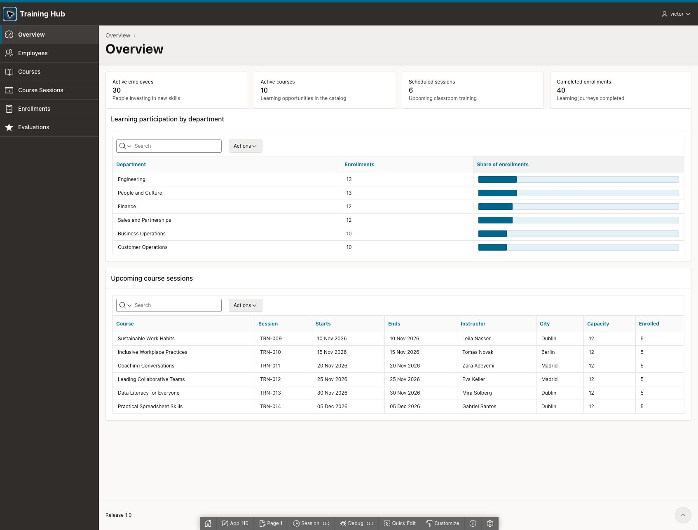

# APEX CI/CD with SQLcl Projects and native APEXlang

A repeatable, presenter-driven demonstration that promotes **Training Hub** and its database structures from development to production using **SQLcl 26.3 Projects**.

The sample has ten related `DEMO_TRN_` tables, fictional development data, and a basic Oracle APEX application. Release **1.0** captures the starting state. For **1.1**, the presenter creates a certification table, adds a course column, and builds a new APEX report page manually. The same release workflow promotes those changes.

Each release opens a GitHub pull request and waits for **manual review and merge**. After merging, the script publishes one deployment ZIP and its SHA256 checksum. Deployment is a separate manual command. Releases transfer **structures and application definitions only**; table rows and supporting-object data installers are excluded.



## Repository roles

| Repository | Purpose |
| --- | --- |
| `vmendo/APEXLangCICD` | This reusable demo framework, initial application, scripts and documentation. |
| `vmendo/apex_ci_cd_demo` | Default **disposable delivery repository** for generated project sources, release PRs and artifacts. Configurable. |

**Keep these repositories separate.** Full cleanup empties the configured delivery repository, preserving the repository resource but replacing the default branch with an empty tree and removing delivery branches, tags, releases and other demo artifacts. Do not configure this framework repository, or another valuable repository, as the delivery target.

## Requirements

- macOS or Linux with Bash, Git and Python 3.10 or later.
- GitHub CLI (`gh`), authenticated with access to the disposable delivery repository; Git identity and authentication configured for commits/pushes.
- A SQLcl **26.3.0.0** distribution and a compatible JDK. The runtime is copied into `tools/sqlcl-26.3/`; it is not bundled or installed system-wide by this demo.
- Separate Oracle APEX development and production databases with the required schema privileges. The demo was exercised with APEX 26.1.5 in development and 26.1.6 in production. Selected-page cleanup checks an internal API specific to APEX 26.1; `--skip-page` supports manual deletion instead.
- Saved SQLcl development and production ADMIN connections. Wallets, credentials and saved connection definitions are supplied locally and are not included in Git.

The sample application uses APEX Accounts: workspace users are managed separately from database schema credentials.

## Prepare a fresh clone

```bash
git clone https://github.com/vmendo/APEXLangCICD.git
cd APEXLangCICD
cp config/example.env config/local.env
./run/setup/install_sqlcl.sh /path/to/existing/sqlcl-26.3
```

Edit `config/local.env` for your environment. Defaults are source connection `ADB_LOCAL_DEMO`, production ADMIN `ADMIN_ADBFREE`, production connection `DEMO_ADBFREE`, schema/workspace `DEMO`, source application `110`, and delivery repository `vmendo/apex_ci_cd_demo`.

Create an empty delivery repository that you control, or deliberately reset the dedicated demo repository before reuse. The framework's own branch is `master`; the generated delivery project defaults to `main`. These are separate Git histories.

1. Create the initial development model/data and import the saved initial app using [Initial setup](docs/INITIAL_SETUP.md). The workspace/schema and an APEX developer account must already exist. The SQL application snapshot is **only for this initial installation**; CI/CD exports live sources natively as APEXlang.
2. Save the required development and production ADMIN connections in the controlled SQLcl runtime. Use the connection names configured above, or change the configuration.
3. Provision/verify production infrastructure once:

   ```bash
   ./run/setup/setup_production.sh
   ```

   This prepares the schema/workspace and creates or verifies its saved SQLcl connection. It retains a private local identity record required by later stages. If the schema already exists without a saved connection, follow [the runbook](docs/RUNBOOK.md) for `DEMO_PRO_PASSWORD_FILE` or save the connection manually first. No APEX login user is created.

## Run the presentation

Run commands from the framework root, one stage at a time:

```bash
./run/create_project.sh TrainingHubCICD
./run/create_release.sh baseline 1.0
# Review and merge the PR manually; wait for automatic artifact publication.
./run/deploy_project.sh PRO 1.0
./run/validate_deployment.sh baseline
```

Next, in **development** SQL Workshop > SQL Scripts, manually execute:

1. `scripts/demo_changes/01_create_certifications.sql`
2. `scripts/demo_changes/02_add_certification_required.sql`

In App Builder, create a Certifications interactive report over the new table and add its navigation entry. Choose a free page ID and record it. Then:

```bash
./run/create_release.sh certifications 1.1
# Review and merge manually; wait for automatic artifact publication.
./run/deploy_project.sh PRO 1.1
./run/validate_deployment.sh incremental 200
```

Replace `200` with the actual report page ID. The production application prefers the source ID when free; otherwise it receives a free ID, retained across releases and cleanup. The project name argument, connections, schema/workspace, application IDs, delivery repository and project location are configurable.

Full presenter guidance: [Manual demo](docs/MANUAL_DEMO.md), [Manual APEX changes](docs/MANUAL_APEX_CHANGES.md), [Runbook and recovery](docs/RUNBOOK.md).

## Optional data and cleanup

[Presentation data helpers](docs/OPTIONAL_DEMO_DATA.md) populate the new development page or an empty migrated production app. They run manually, outside migrations. Seed production only after the final structures-only validation, which expects empty tables.

```bash
./run/clean_demo.sh
```

Cleanup lists development pages and asks which release pages to remove; it uses the recorded production application ID. Page/app deletion can be skipped. It preserves the ten-table development baseline and data, production schema/workspace, framework files and SQLcl runtime. It removes the certification extension, owned production objects, delivery content and generated project, and clears previous logs at startup while keeping its own logs. One-time setup is not repeated after ordinary cleanup.

Review remote scope without changing GitHub:

```bash
./run/clean/cleanup_remote.sh --dry-run
```

See the [runbook](docs/RUNBOOK.md) for explicit IDs, skip flags, confirmation behavior and recovery guards.

## Layout and offline checks

| Path | Content |
| --- | --- |
| `run/` | Presenter entry points. |
| `run/aux/` | Automatically called checks, publication and deployment helpers. |
| `run/setup/` | One-time runtime and production setup. |
| `run/clean/` | Cleanup stages and cleanup-only helpers. |
| `scripts/training/` | Initial model, seed and verification SQL. |
| `scripts/setup/training-hub/` | Fixed initial application SQL export. |
| `scripts/demo_changes/` | Two manually executed release 1.1 schema changes. |
| `scripts/demo_data/` | Optional, manually generated presentation data. |
| `applications/training-hub/` | Editable APEXlang baseline sources. |
| `config/` | Non-secret defaults and runtime manifest. |
| `tests/` | Offline tests using temporary directories and mocked external services. |

Run the offline tests without a database, GitHub account or SQLcl installation:

```bash
python3 -m unittest discover -s tests
```

Generated projects, runtime binaries, logs, local state/configuration and credentials are excluded from this repository. Oracle documentation and implementation references are listed in [Sources](docs/SOURCES.md).
